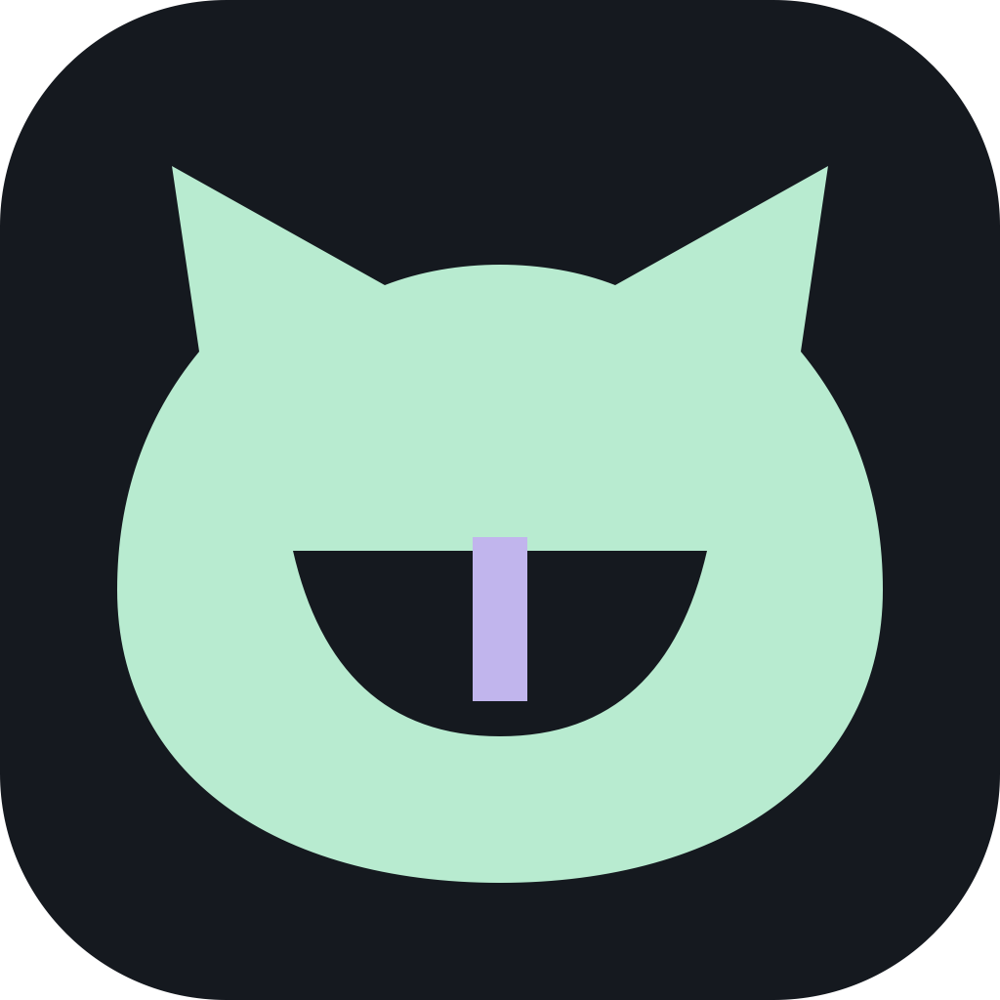

<p align="center"></p>
<h1 align="center">larpcord</h1>
<p align="center">a little room to breathe.</p>
<p align="center">a native discord client, written in rust with gpui.</p>

this is kawaicord's native sibling. same obsession with keeping background work small, with a fresh interface and its own codebase. first milestone is getting the everyday text client right. then we tackle native calls, media and mod adapters. the current published preview is available in [releases](https://github.com/evenafterallisaid/larpcord/releases/tag/v0.2.0-dev.12).

**0.2.0-dev.12 is a development preview.** this release adds sharper streaming gifs, click-to-send picks, account emoji recents, inline composer emoji, smoother navigation and more stable profiles. the login screen offers qr sign-in and a clearly labelled offline sample workspace. connecting an account enables the real rest and gateway implementation. live account sign-in, sending and receiving have been confirmed on macos. existing kawaicord installs and sessions are separate.

## what works in this milestone

- native gpui window, discord-style layout, shared account card, back/forward navigation, macos traffic lights and dark first paint
- native discord qr login with mobile confirmation; no manual token required for that flow
- layered charcoal surfaces, a single compact title/navigation bar, virtualized server and dm lists, recent dm ordering and conversation filtering
- a friends home with online/all filters, search, live relationship updates and opening direct conversations
- live dm presence badges and activity lines, with native idle, busy and offline shapes
- automatically paged history in both directions, date and unread separators, jump to latest, grouped messages, reply previews and composing replies, sending, live edits and deletions
- image attachments, png/apng/gif stickers, static custom emoji, a tabbed picker for unicode/server emoji, searchable GIFs and server/standard sticker packs, markdown, bot embeds and components v2 layouts
- ordinary and super reaction displays, separate counts, your-reaction highlighting, native burst/hover animation and live add/remove updates
- a collapsible channel list, bounded on-demand member sidebar with roles and presence, and a floating translucent jump-to-latest control with quick fades, smooth scrolling and subtle edge rebound
- gif-only messages use clean media tiles without the repeated url or embed border; replies show a compact gif label
- aligned member portrait columns with and without nameplates, including loading rows
- contained message hover controls with quick account-ranked reactions, an emoji submenu, reply/copy/profile actions and matching right-click menus
- bot buttons and string selectors through discord interactions, plus explicit link controls
- a nonblocking dm profile inspector, expandable full profiles, live presence/activity, badge artwork, a direct-message action, clickable mutual friend/server lists, profile theme colors and overlapping avatars, banners, biographies, pronouns, server identity, decorations, layered frames, bounded effects and role chips
- server icons, banners and group chat icons, saved server order and folders, unread/mention badges, a flat single-color home mark and custom typing indicators
- silent, bounded gifv autoplay and image gif/apng motion; click-to-play video attachments, cdn video embeds and components v2 video galleries, with a native viewer, seeking, volume and mute
- floating settings with mouse, scroll and keyboard isolation; charcoal, onyx, midnight and rose themes with a semantic custom-theme token file
- gateway heartbeats, acknowledgement checks, session resume, reconnection backoff and automatic retry after a transient startup failure
- desktop notifications for direct messages, mentions and incoming call signals
- optional saved login in keychain, credential manager or secret service
- per-conversation drafts, compact spacing, notification privacy and background connection settings

clicking a gif sends it immediately as its own message, while preserving your text and staged sticker. emoji and stickers still go into the composer for review before sending. local emoji, sticker and gif history survives restarts. the emoji picker also reads the account’s synced message/reaction rankings, so saved official-client and kawaicord usage carries over. selections made here are prioritized locally; pending usage not yet saved by the other client is unavailable. custom emoji render inline in the composer while the send payload retains native markup. the gif selector also reads discord favorites and offers explicit star changes without replacing unrelated saved records. sticker messages use native sticker ids and preserve per-channel drafts; png/apng/gif artwork is supported, while lottie artwork currently uses a named placeholder.

voice and video calls, email/password login, quest integration and javascript plugin compatibility are future work. normal reactions can be added or removed using quick actions, the emoji picker or existing reaction chips. original discord nitro animation assets and lottie sticker playback are not implemented yet. incoming call notifications are informational until native voice is implemented. this milestone adds native qr login through discord mobile, with manual session entry retained under advanced sign-in. the ui never reads a token from another application. the live qr handshake passed on 2026-11-12. the user has also confirmed account access and real message delivery; the exact sign-in route was not separately recorded.

## run it

```sh
cargo run --release --locked
# offline sample workspace without reading saved credentials
cargo run --release --locked -- --preview
```

the login screen generates a qr code through discord's remote authentication service. scan it using the discord mobile app and confirm on your phone. choose explore the preview for the offline sample workspace. manual session entry is available through advanced sign-in. saved sessions reconnect automatically on later launches. disconnect removes the saved credential.

`cmd+k` or `ctrl+k` focuses conversation search. enter sends a message. `cmd+q` or `ctrl+q` quits. closing the window minimizes it by default and keeps the connection alive. change that in preferences.

an account session token is a password. keep it private. larpcord is an independent client and is unaffiliated with discord. discord's [platform rules](https://support.discord.com/hc/en-us/articles/115002192352-Automated-User-Accounts-Self-Bots) apply to account use.

## keeping the footprint small

- only visible messages, server icons and direct-message rows are laid out and painted
- actual videos start after a click in one viewer and release when it closes, with bounded queues and two software decoder threads; gifv and image gif loops share at most four visible players, release offscreen and pause when inactive; image gifs decode one requested frame at a time instead of storing a low-resolution loop, with one queued result and 800 × 600 output bounds
- at most 12 conversation histories, with 200 messages each, live in memory
- switching conversations evicts the least recently used history while retaining the active one
- public encoded images have a bounded 64 mib disk cache, reused after scrolling or restarting; portraits/icons have four dedicated download slots and content has two, with one decode permit reserved for each queue
- recently viewed member lists are retained for up to 60 seconds, with at most two previous channel views
- visible images decode off the ui thread; portraits and content have separate soft allowances of 8 mib and 12 mib, with 768 and 384 soft entry allowances respectively; a visible working set can use up to three times its byte allowance, with artwork retention guarded at twice the entry allowance
- media uses public discord cdn requests without account credentials; external links open only after a click
- animated emoji use a still frame for now; super reactions have short native particle bursts and hover replay, with reduced-motion support
- interface motion pauses in inactive windows; the network service runs on a two-worker rust runtime, independently of window rendering
- the ui waits for pushed events. it has no refresh loop or background game scanner
- history merges preserve concurrent message edits, reaction changes, new messages and deletions
- api requests share a rate limit lane, honor retry delays and bound response bodies
- sending clears the submitted draft immediately; later typing survives acknowledgements
- no automatic retry after an ambiguous send failure. the unsent text stays available to copy and check before resending

performance numbers will be recorded against an identified build and workload. a quiet sample workspace is a baseline, and an active account needs its own measurement.

## build requirements

rust 1.99.1 is pinned in `rust-toolchain.toml`. macos builds use the command line tools and compile metal shaders at runtime. windows builds use the msvc toolchain and nasm. x86 linux builds also need nasm for the av1 decoder. linux needs the development libraries listed in [the build workflow](.github/workflows/ci.yml), plus a working gpu driver and an unlocked secret service for saved sessions.

```sh
cargo fmt --all --check
cargo clippy --locked --all-targets -- -D warnings
cargo test --locked
cargo build --release --locked
```

macos packaging uses `sh packaging/bundle-macos.sh`. it creates `dist/Larpcord.app` with an ad hoc signature. notarization and a signed self-updater are future release work. the build workflow produces separate macos arm64, windows x64 and linux x64 portable artifacts. platform checks and live feature validation are tracked separately.

## where things live

| file | responsibility |
| --- | --- |
| `src/ui.rs` | native views, navigation, drafts and settings |
| `src/auth.rs` | native rsa key exchange, qr generation and login ticket handling |
| `src/input.rs` | unicode text input and masked session entry |
| `src/model.rs` | typed data, bounded cache and concurrent history merging |
| `src/network.rs` | rest requests, gateway lifecycle and credential access |
| `src/media.rs` | bounded public cdn downloads, off-thread image decoding and viewport-driven caching |
| `src/content.rs` | custom emoji and markdown parsing |
| `src/video.rs` | on-demand native decoding, playback controls and bounded buffering |
| `src/settings.rs` | first-run defaults and atomic configuration writes |

## credits

[gpui](https://gpui.rs/) provides rendering and native window integration. the input control adapts its apache-licensed example. [serein](https://github.com/ViceVerse-cz/Serein), [oxidecord](https://github.com/s1099/oxidecord) and [zcord](https://github.com/torikushiii/zcord) were useful ecosystem references. the larpcord implementation is independent. dependency and source attribution is in [third party notices](THIRD_PARTY_NOTICES.md).

mit, with the adapted text input covered by apache-2.0. see [license](LICENSE) and [third party notices](THIRD_PARTY_NOTICES.md).

## branding

the chosen [glass mascot and wordmark](https://chatgpt.com/s/m_6af5e32be8808191b002af94fa3ea8e0) are preserved in `assets/brand-source.png`. app icons use a derived mascot-only treatment. source and preparation details are in [assets](assets/README.md).

## current rendering limits

avatars, banners and message emoji use still artwork. decorations and supported effect layers animate only on hover or in the open profile, subject to reduced-motion settings and strict decoding limits. nameplates use still artwork in dm and account rows, with supported motion on hover. frames render their own staple, rail and repeated border layers. bundled display-name fonts and color gradients render natively; unavailable font families fall back to inter, and discord’s exact neon/glow/prism/gummy shader treatments remain approximations. custom typing emojis, verbs and pulse/ring/wave treatments use the received user style; multiple typists use the normal combined indicator. embed titles, descriptions, fields, images and footers render natively. components v2 containers, sections, text displays, thumbnails, galleries, files and separators render natively too. buttons and string selectors can submit interactions; entity selectors, bot modal forms and premium purchase controls are still pending. sticker sending and png/apng/gif artwork work; lottie artwork is pending. extended profiles load only when opened, use the server identity where provided, and are cached for five minutes with at most 32 entries. the selected older history can retain up to 200 additional live messages while you browse; returning to latest merges that tail and keeps the normal bounded window.

message and cdn fields follow discord's [message schema](https://docs.discord.com/developers/resources/message), [user schema](https://docs.discord.com/developers/resources/user) and [image formatting reference](https://docs.discord.com/developers/reference#image-formatting).

typing starts are rate limited to one signal every eight seconds while actively editing. incoming indicators expire after ten seconds, stop when a message arrives, and are scoped to the selected conversation. the gateway subscribes to typing in the viewed server and clears the previous subscription. no typing timer runs while idle. profile and component rendering live in `src/ui/` so the main conversation view can stay focused on navigation and state.

current user-client protocol details and their verification limits are in [protocol notes](docs/protocol-notes.md).

## video playback

[alhazen-gpui](https://github.com/alhazen-rs/alhazen-gpui) supplies native video rendering. macos uses videotoolbox for h.264/hevc and windows uses media foundation. vp9/opus and other included software codecs work without an external player. linux h.264 needs a supported va-api or nvidia decoder; unsupported codecs show an error with an explicit original-file link. no ffmpeg executable is launched. videos use public cdn urls, never the discord account credential. external video websites and arbitrary remote players are not embedded. spoiler videos require opening their original link.

the layout pass uses discord's [desktop refresh](https://discord.com/blog/player-release-q12025) and serein's public screenshots as visual references. it does not reproduce unavailable features as inert buttons. the app icon remains colored; only the home/dm mark is a flat svg.
